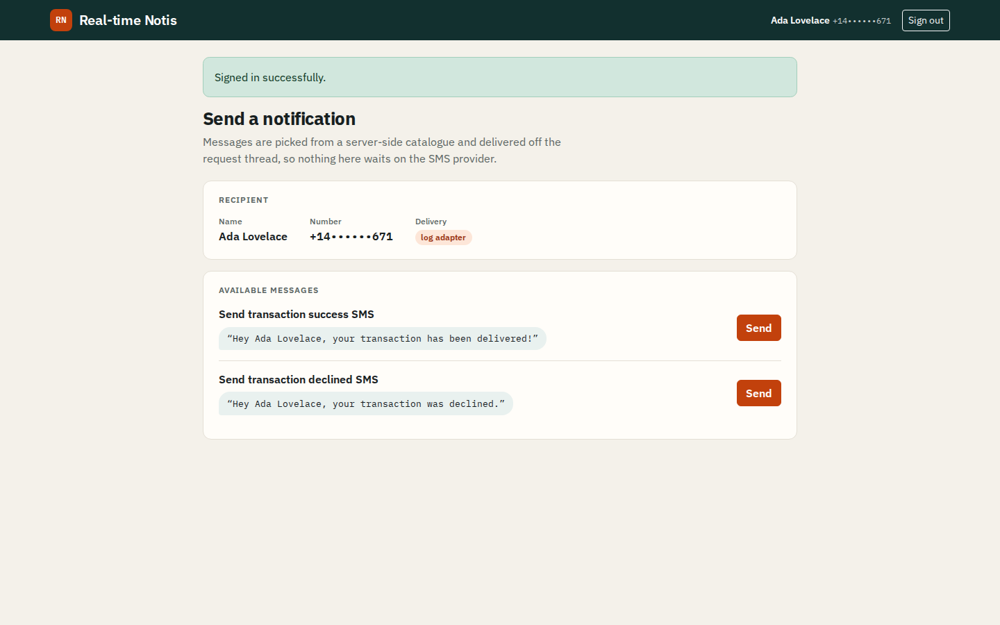
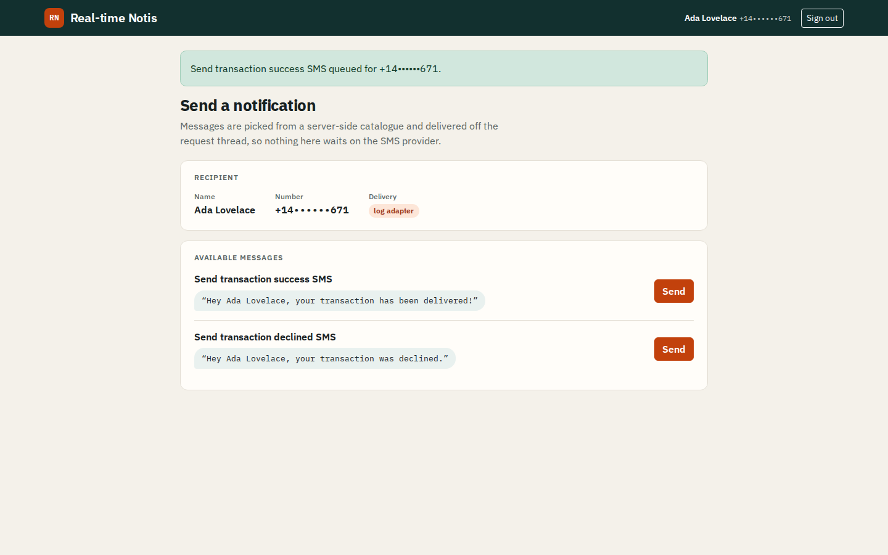
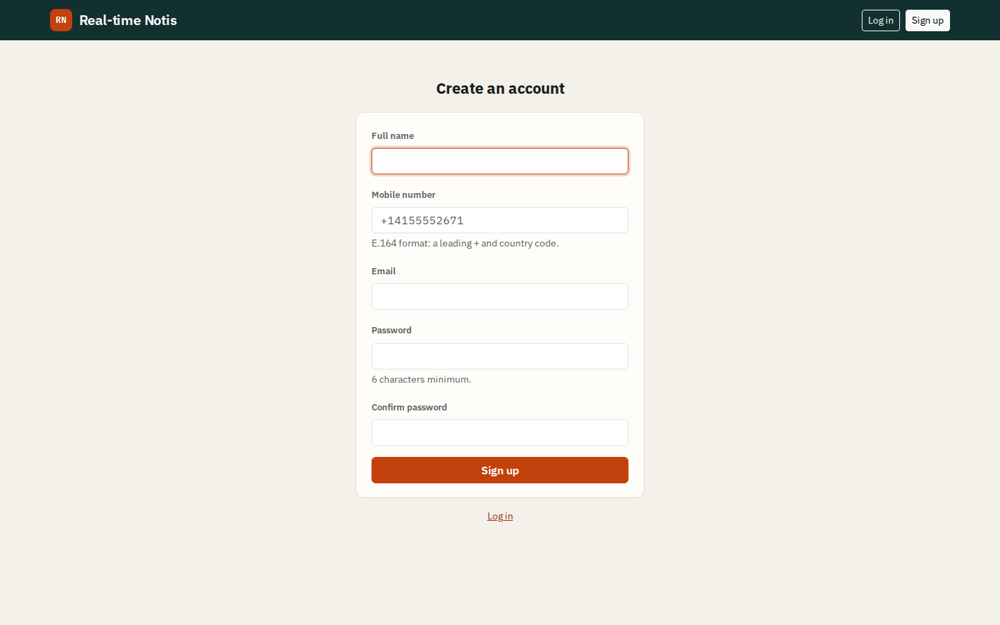
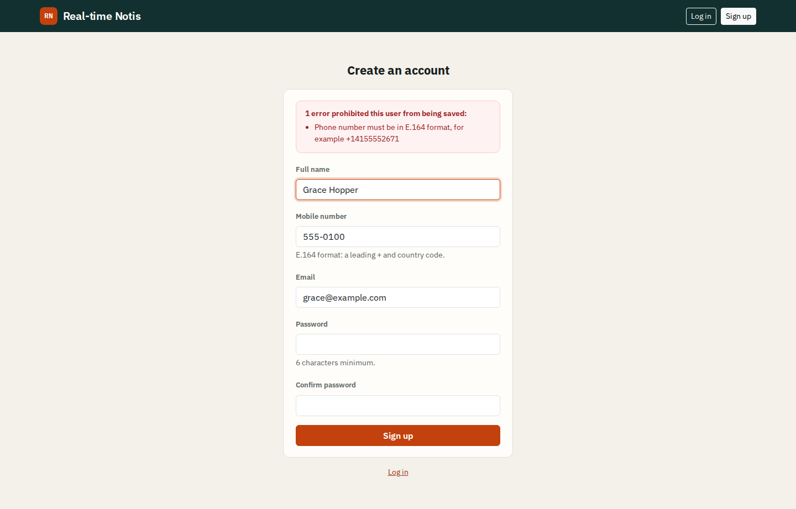
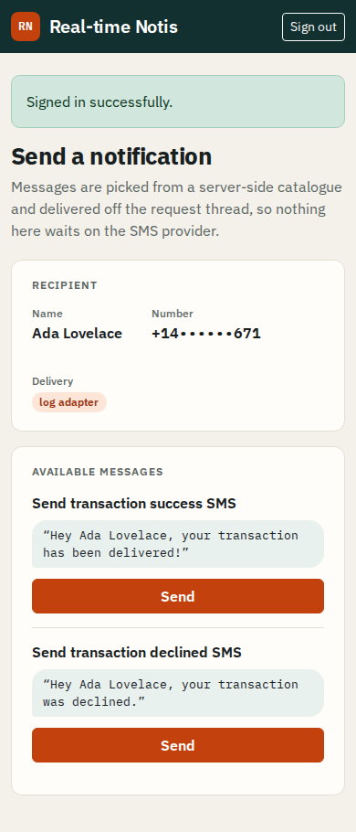
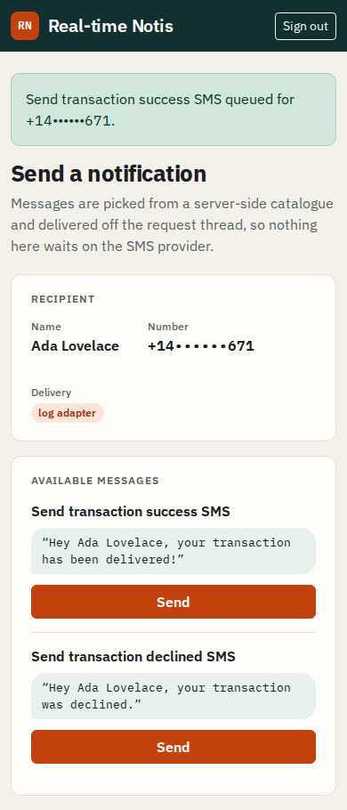
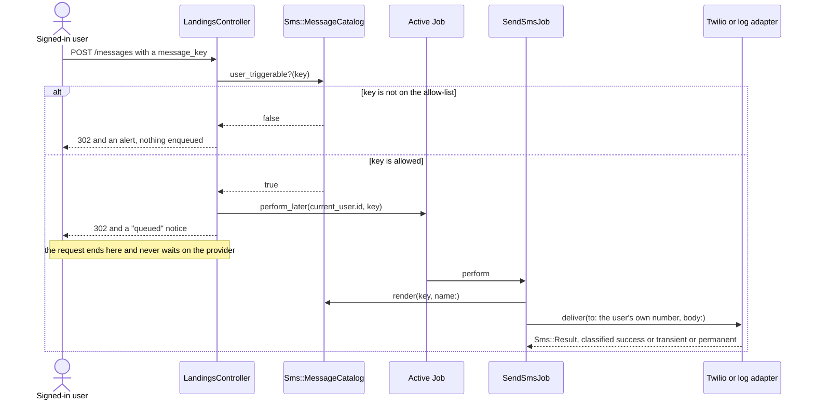
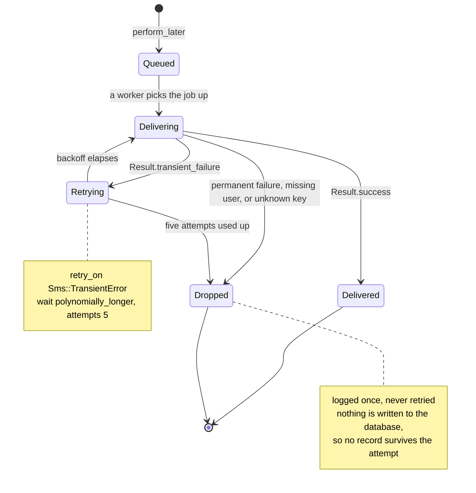

# Real-time Notis

A small Rails 8.1 app that sends transactional SMS to the signed-in user.
People register with a phone number, get a welcome text, and can trigger one
of a fixed set of messages from a single dashboard. Twilio delivers them —
but with no Twilio credentials configured the app falls back to a log
adapter, so the whole thing runs end to end on a laptop with no account and
no spend.

**A note on the name.** "Real-time" here means a text message goes out the
moment an event happens, not that the browser gets pushed to. Action Cable is
mounted at `/cable` and only accepts signed-in users (Redis backs it in
production), but no channel is defined and nothing is broadcast yet. If you
came looking for a browser push pipeline, it is not here.

## The one screen

Everything a signed-in user can do fits on one page: see which number the
message will go to, and press one of two buttons. Each message is previewed
as the text that will arrive. The "log adapter" pill is the app telling you
no Twilio credentials are configured.

| Dashboard | After pressing Send |
| --- | --- |
|  |  |

Sign-up takes a name and an E.164 number, and rejects anything else before a
row is written:

| Sign-up | Rejected number |
| --- | --- |
|  |  |

On a phone each message stacks above a full-width Send button:

| Dashboard, 390×844 | After pressing Send, 390×844 |
| --- | --- |
|  |  |

All six were captured with Playwright against the Docker Compose stack on the
log adapter, signed in as the seeded demo account. Request transcripts, the
latency measurement and the test output are in
[docs/captured-output.md](docs/captured-output.md).

## From button press to text message

The interesting part is what the request does *not* do: it never talks to
Twilio. The controller checks the key against a catalogue, enqueues a job and
returns. A worker does the delivery.



Sign-up takes the same path from a different entry point: `User` has
`after_commit on: :create`, so the welcome SMS is enqueued only once the row
is durably committed.

## Running it without a Twilio account

### With Docker Compose

The stack is the production image plus PostgreSQL 16 and Redis 7. It needs
nothing but Docker:

```bash
cp .env.example .env
echo "SECRET_KEY_BASE=$(openssl rand -hex 64)" >> .env
docker compose up --build        # http://localhost:8860
```

The first boot creates the database, runs the migrations and seeds a demo
account. Sign in as `demo@example.com` / `correct horse battery`, or register
a new one. With the `TWILIO_*` values left empty, messages go to the web
container's log instead of a phone:

```bash
docker compose logs web | grep sms:log
# [sms:log] to=+14••••••671 body="Hey Ada Lovelace, your transaction has been delivered!"
```

Compose sets `FORCE_SSL=false` so the app answers on plain
`http://localhost`. Behind a TLS-terminating proxy, leave it unset and SSL is
forced as usual. `docker compose down -v` removes the stack and its data.

### Without Docker

Requires Ruby 3.4.12 (see `.ruby-version`) and a local PostgreSQL.

```bash
bundle install
bin/rails db:prepare
bin/rails server
```

Open <http://localhost:3000>. Development uses the in-process async adapter
for Action Cable, so Redis is not needed. Messages land in
`log/development.log`.

Fill in the three `TWILIO_*` variables to send for real.

## When the provider is slow or down

Adapters do not raise on a delivery failure. They return an `Sms::Result`
that classifies it, and `SendSmsJob` decides what that classification means:
a provider 5xx or a connection reset is worth another go, an unroutable
number never will be.



Because none of this happens on the request thread, a provider slowdown costs
the user nothing. A measurement committed in
[docs/captured-output.md](docs/captured-output.md#2-request-latency-when-the-provider-is-slow)
puts a deliberate 1.5 s delay in the adapter and compares the two shapes:
delivering inline makes `POST /messages` take ≈1.52 s, enqueueing makes it
≈8 ms. On Puma's default five threads the inline shape saturates at roughly
three requests per second while the provider is slow.

Two specs pin the behaviour that matters here: `spec/requests/registrations_spec.rb`
*"still creates the account when the SMS provider is down"*, and
`spec/controllers/landings_controller_spec.rb` *"does not deliver inline"*.

## Two rules the code keeps

**No web request ever calls the SMS provider.** Controllers and model
callbacks enqueue. `SendSmsJob` is the only thing that touches an adapter.
This is what stops a Twilio outage from rolling back a valid sign-up or
turning into a 500.

**No caller ever supplies message text.** `Sms::MessageCatalog` owns all
three bodies and decides who may trigger each one — `:welcome` is marked
system-only, so it cannot be replayed from the browser. The recipient is
always `current_user.phone_number`; a `user_id` or `phone_number` in params
is ignored, and `spec/requests/messages_spec.rb` asserts exactly that. Without
this, a signed-in user could send arbitrary text at the operator's expense.

Adding a second provider is one class and one line, with no caller changes:

```ruby
Sms::Deliverer.register("vonage") { Sms::VonageAdapter.new }
# SMS_ADAPTER=vonage bin/rails server
```

Phone numbers are masked wherever they are shown or logged — `+14155552671`
renders as `+14••••••671` in the UI, in flash messages and in log lines.

## Environment variables

Outside production every one is optional, and the app boots and works with
none of them set. `.env.example` lists the ones Compose reads.

| Name | Required | Default | Purpose |
| --- | --- | --- | --- |
| `SECRET_KEY_BASE` | Production and Compose | — | Session and cookie signing. Compose refuses to start without it. |
| `DATABASE_URL` | No | from `config/database.yml` | PostgreSQL connection. Overrides the YAML when set. |
| `REDIS_URL` | Production | `redis://localhost:6379/1` | Action Cable pub/sub. Compose points it at its `redis` service. |
| `FORCE_SSL` | No | `true` in production | `false` serves plain HTTP. Compose sets it to `false`. |
| `TWILIO_ACCOUNT_SID` | For real SMS | credentials `twilio.account_sid` | Twilio account SID. |
| `TWILIO_AUTH_TOKEN` | For real SMS | credentials `twilio.auth_token` | Twilio auth token. |
| `TWILIO_FROM_NUMBER` | For real SMS | credentials `twilio.from_number` | Sending number, E.164. |
| `SMS_ADAPTER` | No | `twilio` if all three above are set, else `log` | Forces an adapter by name. |
| `QUEUE_ADAPTER` | No | `async` | Active Job backend. `async` is in-process — use a durable one in production. |
| `WEB_CONCURRENCY` | No | CPU count; `2` in Compose | Puma worker processes in production. |
| `DEVISE_SECRET_KEY` | No | `secret_key_base` | Overrides Devise's token secret. |
| `DEVISE_PEPPER` | No | none | Password pepper. Changing it invalidates existing passwords. |
| `MAILER_SENDER` | No | `no-reply@example.com` | `From:` on Devise emails. |
| `SEED_EMAIL` / `SEED_NAME` / `SEED_PHONE` / `SEED_PASSWORD` | No | demo values | Overrides for `db:seed`. |
| `WEB_PORT` | No | `8860` | Host port in `docker-compose.yml`. |
| `POSTGRES_PASSWORD` | Compose only | `development-only` | Password for the compose `db` service. |

## Working on the code

```bash
bundle exec rspec       # 60 examples
bundle exec rubocop     # rubocop-rails-omakase
bin/rails db:seed       # idempotent demo account
```

The suite needs PostgreSQL and nothing else. Active Job runs on the `:test`
adapter, `config/environments/test.rb` pins the SMS layer to the log adapter,
and WebMock's `disable_net_connect!` blocks every outbound connection — **no
spec can reach the network**, which matters for a codebase whose whole job is
calling a paid third-party API.

The SMS layer lives in `app/services/sms/`: `deliverer.rb` is the port and
the named adapter registry, `message_catalog.rb` holds every sendable message
and who may trigger it, `twilio_adapter.rb` and `log_adapter.rb` are the two
implementations, and `result.rb` is the value object they return.
`app/jobs/send_sms_job.rb` is the only caller of an adapter.
`app/channels/application_cable/connection.rb` identifies each socket by the
Devise user and rejects anonymous ones, so a future channel can scope its
streams to `current_user`. `test/` holds only the Minitest helpers `rails new`
generated; RSpec is the real suite.

## What this does not do

- **No Action Cable channels or browser push**, despite the name. The
  connection layer is authenticated, but nothing subscribes or broadcasts.
- **No delivery confirmation.** The dashboard says *queued*, not delivered.
  Twilio status callbacks are not implemented.
- **No delivery record at all.** Nothing is written to the database when a
  message is sent, so there is no history, no audit trail and no idempotency
  key — a retried job sends the message a second time.
- **`QUEUE_ADAPTER=async` loses queued messages on restart.** It is an
  in-process thread pool with no persistence. That includes the demo
  account's welcome text, which is enqueued during the first-boot seed by a
  process that exits straight away.
- **No rate limiting.** The allow-list caps *what* can be sent, not how
  often. A real deployment needs a per-user throttle.
- **Phone numbers are never verified.** Anyone can register with someone
  else's number and cause a text to be sent to it.
- **No encrypted credentials file is shipped.** `Sms::TwilioAdapter` still
  falls back to `twilio.*` in Rails credentials if you add your own, but the
  `TWILIO_*` variables are the supported path.
- **One dashboard, two messages.** The catalogue is a frozen constant, so
  changing the copy means a deploy.

## Licence

MIT. See [LICENSE](LICENSE).
